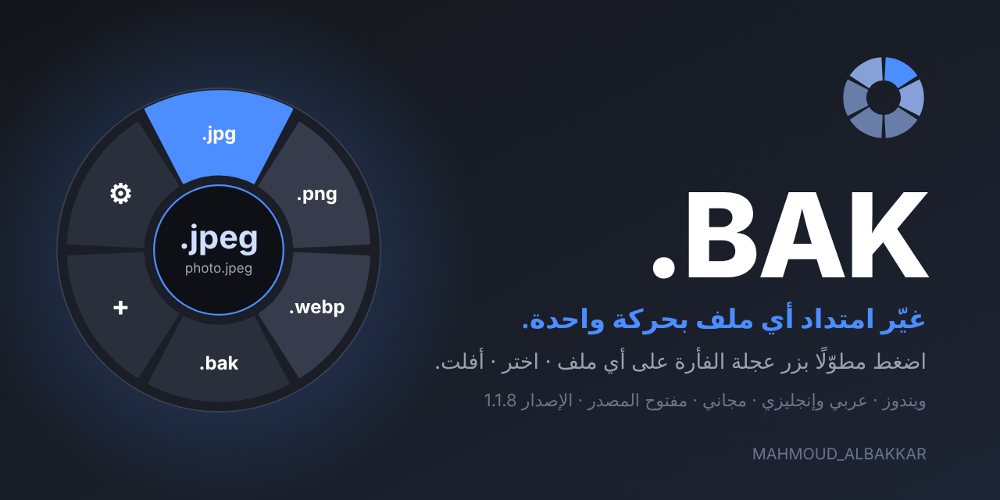
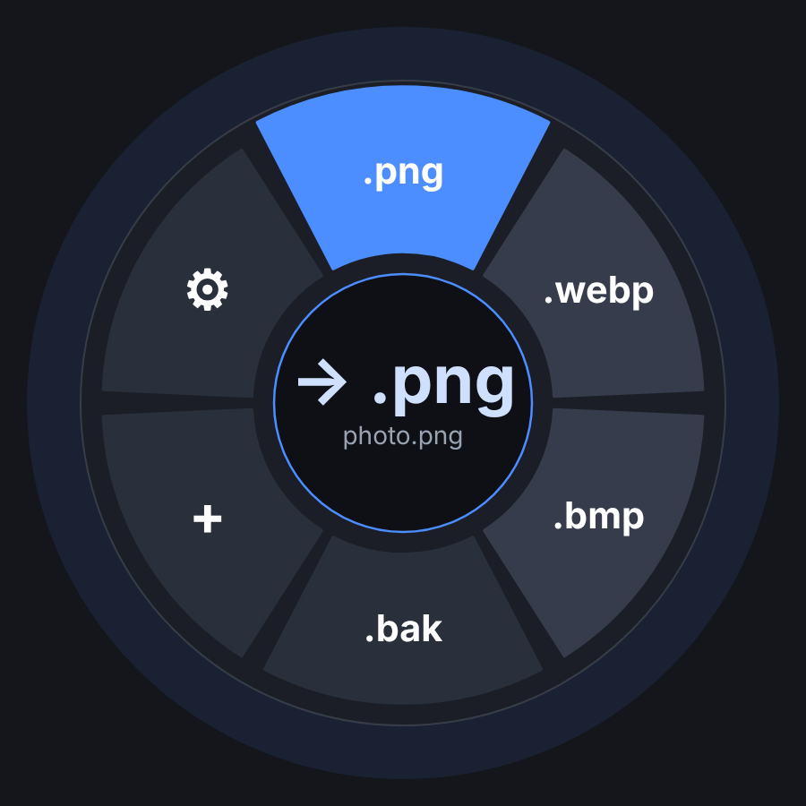

<div align="center" dir="rtl">



# .BAK

**غيّر امتداد أي ملف بحركة واحدة.**
اضغط مطوّلًا بزر عجلة الفأرة على ملف في مستكشف ويندوز أو على سطح المكتب، اسحب إلى الامتداد الذي تريده، ثم أفلت.

  

[English](README.md) · [سجل التغييرات](CHANGELOG.md) · [الإبلاغ عن مشكلة](https://t.me/+NonxC28MrMBjYjlk) · [الرخصة: MIT](LICENSE)

</div>

<div dir="rtl">

---

## المزايا

- **عجلة دائرية** بجانب المؤشر تعرض الامتدادات المناسبة لنوع الملف. اضغط مطوّلًا ← اسحب ← أفلت، أو انقر.
- **قوائم جاهزة** – التحويلات الشائعة معبّأة من البداية: `.txt` ← `.py .json .md .csv .html ...` و`.jpeg` ⇄ `.jpg` وغيرها كثير. وتستطيع تعديلها في أي وقت.
- **أزرارك واختصاراتك** – اختر زر العجلة (زر العجلة أو زر جانبي) وغيّر الاختصارين (فتح العجلة `Ctrl+Alt+E`، التراجع `Ctrl+Alt+Z` افتراضيًا).
- **خيار التحديد التلقائي** – مفعّل: يُحدَّد الملف تحت المؤشر تلقائيًا؛ معطّل: حدّد الملف أولًا ثم اضغط زر العجلة.
- **اقتراح ذكي** – يقرأ محتوى الملف الحقيقي (صور، PDF، Office، ZIP، صوت وفيديو، نص، JSON ...) ويضع الامتداد *الصحيح* أولًا.
- **حماية** – تنبيه قبل امتداد لا يطابق المحتوى، وقبل تحويل ملف إلى نوع قابل للتنفيذ (`.exe` و`.bat` و`.ps1` ...).
- **نسخ احتياطي واستعادة** – قطاع `.bak` ينسخ الملف إلى `name.ext.bak`، وعلى ملف `.bak` يعيد القطاع الأول الاسم الأصلي.
- **تراجع عن كل شيء** – كل تغيير يُحفظ في سجل يبقى بعد إعادة التشغيل، وفي الإشعار زر *تراجع*.
- **عربي وإنجليزي** – تُختار اللغة من لغة ويندوز عند أول تشغيل (عربي إن كان ويندوز عربيًا وإلا إنجليزي) ويمكن تبديلها في أي وقت، وتنعكس الواجهة تلقائيًا.
- **زر حفظ** – الحفظ تلقائي، وزر *حفظ الإعدادات* يمنحك تأكيدًا واضحًا.
- **الإبلاغ عن مشكلة** – نقرة واحدة تفتح مجموعة تيليجرام.
- **خصوصية** – بلا اتصال بالشبكة وبلا تتبّع، ولا يغادر شيء جهازك.

<div align="center">

<br><sub>صورة توضيحية للعجلة.</sub>
</div>

## التثبيت

1. نزّل المشروع (أو `git clone`).
2. شغّل **`Install.bat`** بنقرتين. يبني `BAK.exe` بمترجم C# المرفق مع ويندوز 10/11 (لا حاجة لـ SDK ولا Visual Studio)، وينسخه إلى `%LOCALAPPDATA%\Programs\BAK`، ويفعّل التشغيل مع ويندوز ثم يشغّله.
3. أو نزّل `BAK.exe` من صفحة [الإصدارات](../../releases).

للإزالة شغّل **`Uninstall.bat`**.

## الاستخدام

| الإجراء | الطريقة |
|---|---|
| فتح العجلة | اضغط مطوّلًا بزر العجلة (افتراضيًا زر عجلة الفأرة) على ملف في المستكشف أو سطح المكتب |
| اختيار امتداد | اسحب إلى قطاع ثم أفلت (أو اضغط رقمه، أو انقر عليه) |
| فتح العجلة بالكيبورد | حدّد الملف واضغط `Ctrl+Alt+E` (قابل للتغيير) |
| التراجع عن آخر تغيير | `Ctrl+Alt+Z` (قابل للتغيير) أو زر *تراجع* في الإشعار |
| الإعدادات | نقرتان على أيقونة الأداة في شريط المهام |

النقرة القصيرة بزر العجلة تعمل كالمعتاد: تُمرَّر إلى المستكشف.

## البناء من المصدر

```bat
build.bat
```

لا يحتاج إلا ويندوز 10/11 (مترجم .NET Framework 4 ‏`csc.exe`). الناتج: `dist\BAK.exe`.

## الخصوصية والأمان

.BAK يعيد تسمية الملفات التي تشير إليها فقط. لا يفتح اتصالات شبكة ولا يجمع أي بيانات. الإعدادات والسجل في `%APPDATA%\BAK`. تغيير الامتداد يغيّر الاسم فقط ولا يحوّل المحتوى.

## المطوّر

**MAHMOUD_ALBAKKAR** · [GitHub](https://github.com/0mahmoudalbakkar0) · [Telegram](https://t.me/+NonxC28MrMBjYjlk)

مرخّص بموجب [رخصة MIT](LICENSE).

</div>
