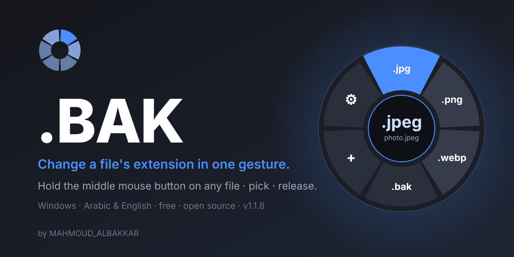
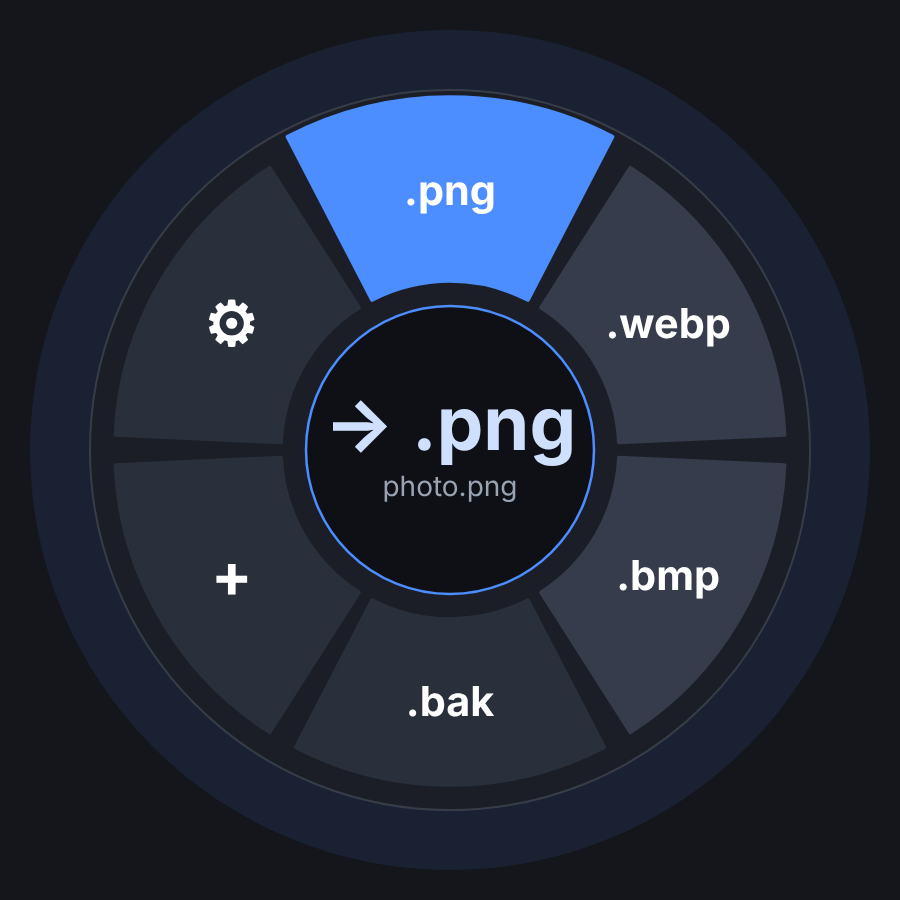

<div align="center">



# .BAK

**Change a file's extension in one gesture.**
Hold the middle mouse button on a file in Windows Explorer or on the desktop, slide to the extension you want, release.

   

[العربية](README.ar.md) · [Changelog](CHANGELOG.md) · [Report a problem](https://t.me/+NonxC28MrMBjYjlk) · [License: MIT](LICENSE)

</div>

---

## Features

- **Radial wheel** next to the cursor with the extensions that make sense for that file type. Hold–slide–release, or click.
- **Ready-made lists** – common conversions are filled in from the start: `.txt` → `.py .json .md .csv .html ...`, `.jpeg` ⇄ `.jpg`, `.htm` ⇄ `.html`, and many more. Edit them any time.
- **Your buttons, your shortcuts** – choose the wheel button (middle button or a side button) and change the two keyboard shortcuts (open wheel `Ctrl+Alt+E`, undo `Ctrl+Alt+Z` by default).
- **Auto-select toggle** – on: the file under the cursor is selected for you; off: select the file first, then press the wheel button.
- **Smart suggestion** – reads the file's real content (PNG, JPEG, PDF, Office, ZIP, audio/video, text, JSON, ...) and puts the *correct* extension first.
- **Safety nets** – warns before an extension that does not match the content, and before turning a file into something executable (`.exe`, `.bat`, `.ps1`, ...).
- **Backup & restore** – a `.bak` sector copies the file to `name.ext.bak`; on a `.bak` file the first sector restores the original name.
- **Undo everything** – every rename is kept in a history that survives restarts; the toast has an *Undo* button.
- **Arabic and English** – the language is chosen from your Windows language on first run (Arabic if Windows is Arabic, otherwise English) and can be switched at any time; the layout mirrors automatically.
- **Save button** – changes are saved automatically, and *Save settings* gives you a clear confirmation.
- **Report a problem** – one click opens the Telegram group.
- **Private** – no network access, no telemetry, nothing leaves your PC.

<div align="center">

<br><sub>Illustration of the wheel.</sub>
</div>

## Install

1. Download the source (or `git clone`).
2. Double-click **`Install.bat`**. It builds `BAK.exe` with the C# compiler that ships with Windows 10/11 (no SDK or Visual Studio needed), copies it to `%LOCALAPPDATA%\Programs\BAK`, enables start-with-Windows and launches it.
3. Or grab `BAK.exe` from the [Releases](../../releases) page.

Uninstall with **`Uninstall.bat`**.

## Use

| Action | How |
|---|---|
| Open the wheel | Press and hold the wheel button (default: middle mouse button) on a file in Explorer or on the desktop |
| Pick an extension | Slide to a sector and release (or press its number, or click it) |
| Open the wheel from the keyboard | Select the file, press `Ctrl+Alt+E` (changeable) |
| Undo the last change | `Ctrl+Alt+Z` (changeable) or the *Undo* button on the toast |
| Settings | Double-click the tray icon |

A short middle-click still behaves normally: it is passed through to Explorer.

## Build from source

```bat
build.bat
```

Requires only Windows 10/11 (the .NET Framework 4 compiler `csc.exe`). Output: `dist\BAK.exe`.

## Privacy & safety

.BAK only renames files you point at. It does not open network connections and does not collect anything. Settings and history live in `%APPDATA%\BAK`. Changing an extension changes the name only – it does not convert the content.

## Author

**MAHMOUD_ALBAKKAR** · [GitHub](https://github.com/0mahmoudalbakkar0) · [Telegram](https://t.me/+NonxC28MrMBjYjlk)

Licensed under the [MIT License](LICENSE).
